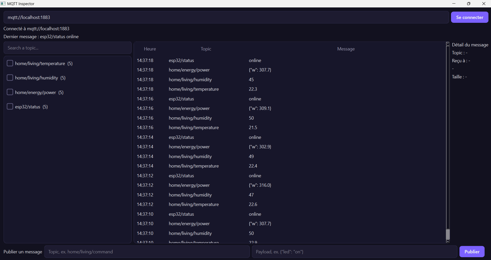

# MQTT Inspector

## About the project

MQTT Inspector is a small desktop application I made with Python. It lets me connect to an MQTT broker, view incoming messages, and publish my own messages.

I can also see the topics that have received messages and their message counts, filter the list with checkboxes, and click a message to see its details.

Here is a screenshot of the application:



## What I need to run it

- Python 3.13 or newer
- [uv](https://docs.astral.sh/uv/) to install the project dependencies
- An MQTT broker I can connect to, for example Mosquitto running on `localhost:1883`

## Installation and launch

In a terminal opened in the project folder, I install the dependencies:

```bash
uv sync
```

I start my MQTT broker, then launch the application:

```bash
uv run python app.py
```

The address `mqtt://localhost:1883` is already entered in the window. I can change it and click **Connect**. The application listens to all topics on the broker.

To generate some example messages, I open a second terminal and run:

```bash
uv run python fake_sensors.py
```

This small program regularly sends example temperature, humidity, power, and connection status messages.

## How I made this project

I built the project one step at a time. First, I tried receiving MQTT messages in the terminal. Then I created the window with PySide6 and added the broker connection. I used a Qt timer to check for incoming messages regularly without freezing the window.

After that, I added the message table, the topic list with counters and filters, the message details panel, and the option to publish a message. I put the window styling in `style.qss` to give it a dark theme. Finally, I wrote tests with `pytest` to check the main features.

## Project files

- `app.py`: the application window and its main features.
- `mqtt_client.py`: basic MQTT client functions and broker address parsing.
- `fake_sensors.py`: a small message generator for testing the application.
- `style.qss`: the window colors and styling.
- `tests/`: the project tests.
- `design/mockup.png`: the mockup I used as a reference.

## Run the tests

```bash
uv run pytest
```
