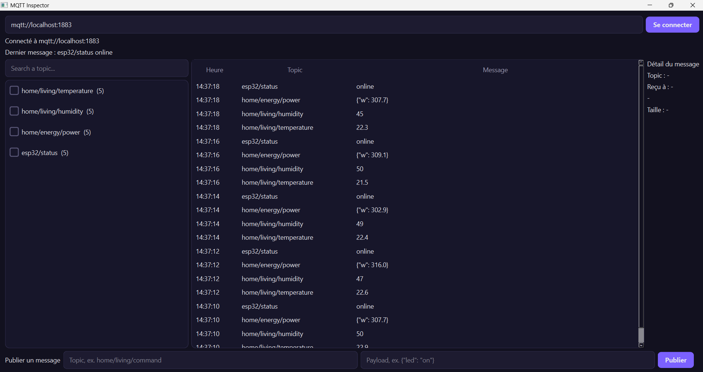

# MQTT Inspector

## Présentation

MQTT Inspector est une petite application de bureau que j’ai faite en Python. Elle me permet de me connecter à un broker MQTT, de voir les messages qui arrivent et d’en publier.

Dans la fenêtre, je peux aussi retrouver les topics reçus avec leur nombre de messages, filtrer l’affichage avec les cases à cocher, et cliquer sur un message pour voir ses détails.

Voici une capture de l’application :



## Ce qu’il faut pour le lancer

- Python 3.13 ou plus récent
- [uv](https://docs.astral.sh/uv/) pour installer les dépendances du projet
- Un broker MQTT accessible, par exemple Mosquitto sur `localhost:1883`

## Installation et lancement

Dans un terminal ouvert dans le dossier du projet, j’installe les dépendances :

```bash
uv sync
```

Je démarre ensuite mon broker MQTT. Puis je lance l’application :

```bash
uv run python app.py
```

L’adresse `mqtt://localhost:1883` est déjà indiquée dans la fenêtre. Je peux la modifier, puis cliquer sur **Se connecter**. L’application écoute tous les topics du broker.

Pour générer des messages de démonstration, je peux ouvrir un deuxième terminal et lancer :

```bash
uv run python fake_sensors.py
```

Ce petit programme envoie régulièrement des valeurs de température, d’humidité, de puissance et un état de connexion.

## Comment j’ai réalisé le projet

J’ai avancé petit à petit. J’ai d’abord essayé de recevoir des messages MQTT dans le terminal. Ensuite, j’ai créé la fenêtre avec PySide6 et ajouté la connexion au broker. J’ai utilisé un timer Qt pour vérifier régulièrement les messages reçus, sans bloquer la fenêtre.

Après ça, j’ai ajouté le tableau des messages, la liste des topics avec leurs compteurs et leurs filtres, le panneau de détails, puis la possibilité de publier un message. J’ai aussi séparé le style dans `style.qss` pour donner à l’application son thème sombre. Enfin, j’ai écrit des tests avec `pytest` pour vérifier les principales fonctions.

## Organisation des fichiers

- `app.py` : la fenêtre et les fonctions principales de l’application.
- `mqtt_client.py` : des fonctions de base pour le client MQTT et la lecture de l’adresse du broker.
- `fake_sensors.py` : un petit générateur de messages pour faire des essais.
- `style.qss` : les couleurs et le style de la fenêtre.
- `tests/` : les tests du projet.
- `design/mockup.png` : la maquette qui m’a servi de référence.

## Lancer les tests

```bash
uv run pytest
```
